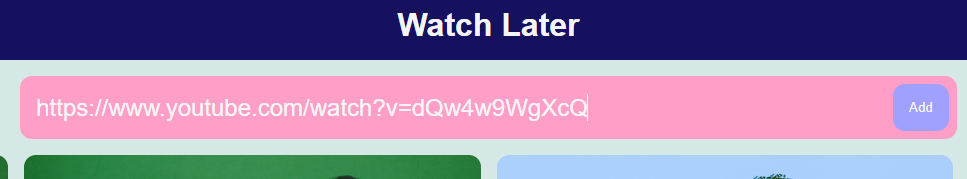
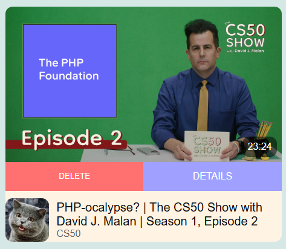
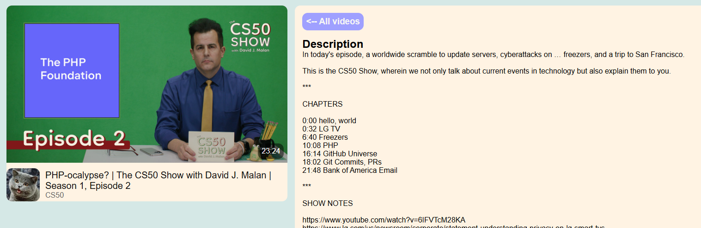

# Watch Later
Video Demo: todo
## Description
A Flask app for keeping a watchlist of Youtube videos. You can add videos with their URL. You can add playlists. You can delete them. You can watch the video by clicking it or visit the channel. 

Why did I create this app? Obviously you can use Youtube's playlist feature. But having a seperate app for keeping a list of videos you want to watch sounds cool and makes it independent from Youtube.

I prefered making a web app because it is easier to make when compared to native applications. I used Flask because it is easy to use. At first I tried making Watch Later as a Go Fyne app then I found concurrency is a hard thing. You need to separate heavy jobs from main thread. In Flask heavy jobs with sync code is fast enough for one user. Additionally drawing to the screen and app logic is already seperated in web apps. Frontend can wait for backends response.

I designed the backend as a REST API instead of Jinja because with this way you can talk with backend externally. You aren't restricted with app's frontend only. Additionally it makes the design simple. API just sends the data. It doesn't know nothing about who makes the request. In the app's frontend javascript makes the API call and draws the page.

I used sqlite for storing data because it is simple and it doesn't have a server client architecture.

App doesn't have any authentication because it is designed for a single user and localhost only.
## How to run
**Api Key**

You need a Youtube Data API key for using this app. Learn more [here](https://console.cloud.google.com/apis/library/youtube.googleapis.com). Copy `.env.example` as  `.env` and paste the key there.

**Virtual Env**

In the project root create a Python virtual environment and install the required packages
```
$ python -m venv env
$ pip install -r requirements.txt
```
**Database**

You can change the database name in the .env file. Default name is `watch.db`. Don't forget to use same name when creating the database.
```
# Linux, Macos and Windows Command Prompt
$ sqlite3 watch.db < schema.sql
# Windows PowerShell
$ Get-Content schema.sql | sqlite3 watch.db
```
**Run the project**
```
# Production
$ waitress-serve --host 127.0.0.1 app:app
# Development
$ flask --debug run
```
## How to Use
Add a video by pasting a URL.



Videos will be displayed in a card layout. You can delete them by clicking delete button or go to the details with details button. You can go to the video on Youtube by clicking it or go to the channel with clicking the channel.



Details page contains a card full of video details and a box with video description.


## Project structure
`app.py` Connects to the database and handles routes.

`helpers.py` Has functions for fetching data from Youtube Data API and appending data to the database.

`seed.py` Fetchs video info from Youtube Data API with some sample video ids and appends them to the database.

`templates/index.html` contains a form for adding videos and an empty div for videos

`static/index.js` is connected to `templates/index.html`. It makes a http request for listing videos and appends them as cards into video div. It also listens for add video form.

`templates/details.html` has an empty div for video details.

`static/details.js` is connected to `templates/details.js`. It makes a http request with the video id in page url. Then appends the video details into empty div.

## Rest API
| Method | Endpoint        | Purpose             | Success | Error   |
|--------|-----------------|---------------------|---------|---------|
| GET    | /api/videos     | List all videos     | 200     | -       |
| POST   | /api/videos     | Create a video      | 201     | 400     |
| GET    | /api/videos/:id | List a single video | 200     | 404     |
| DELETE | /api/videos/:id | Delete a video      | 204     | 404     |

At first i have individual endpoints for every type of request. Like `/api/add` for adding a new video. Then I realized i can combine them. It made the API simpler.

## Storing the data
The database is pretty simple. It stores `video name`, `video description`, `video duration`, `video id`, `channel name`, `channel id` and information about which channel has the video. Thumbnails and channel logos stored in `static/thumbnails` with their video/channel id. Backend builds the information about thumbnail/channel logo location and video/channel links before sending a response. At first I thought about storing the thumbnails in the database. Then I realized you cannot send binary data with json. Storing them as files is simpler. Also storing video/channel links and thumbnail locations in the database is unnecessary. Backend can build them easily. 

## Youtube Data API
| Path          | Purpose                                                   |
|---------------|-----------------------------------------------------------|
| videos        | video title, description, duration, channel id, thumbnail |
| channels      | channel title, logo                                       |
| playlistItems | ids of the videos in playlist                             |